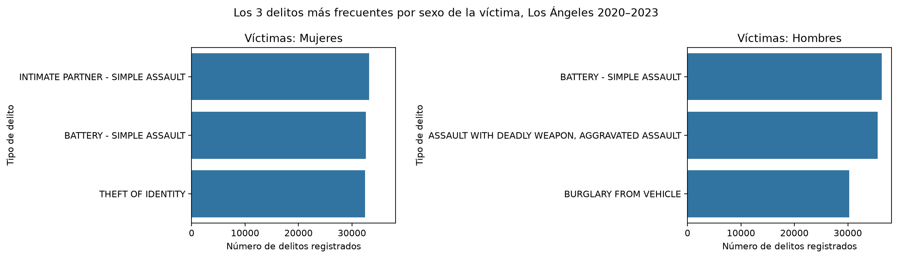
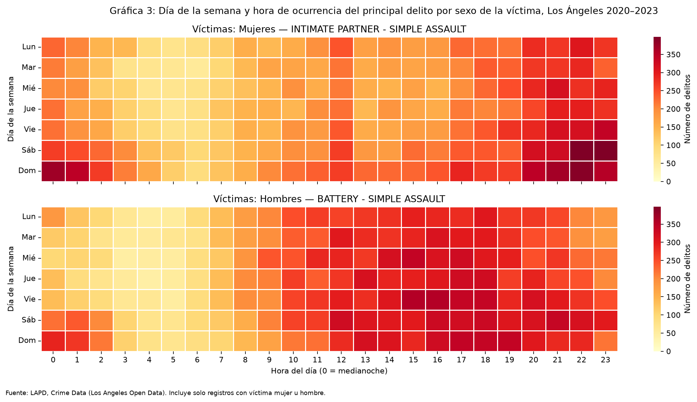
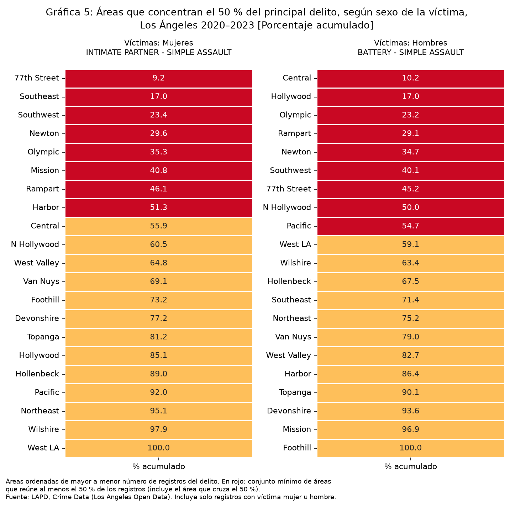

## Introducción

**Pregunta central:** ¿Cuáles son los tres delitos más frecuentes en el acumulado 2020–2023, según el sexo de la víctima?

**Preguntas secundarias:**

1. ¿En qué días de la semana y horas ocurre el principal delito de cada sexo?
2. ¿Qué áreas concentran el 50% del principal delito de cada sexo?

**Fuente:** Crime Data from 2020 to 2024, The Los Angeles Police Department, LAPD (Los Angeles Open Data).

**Enlace:** <https://data.lacity.org/Public-Safety/Crime-Data-from-2020-to-2024/2nrs-mtv8/about_data>

**Periodo y cobertura:** 2020–2023, en las 21 áreas geográficas del LAPD. Aunque la base incluye datos hasta 2024, se excluyó este último año porque el LAPD comenzó a migrar a un nuevo sistema de registro (UCR → NIBRS) y el número de incidentes cayó sin una explicación documentada. Este análisis usa 683,121 registros con víctima mujer (F) u hombre (M), equivalentes al 77.9% de los registros totales del periodo 2020–2023.

**Audiencia:** Público general y estudiantes interesados en la incidencia delictiva de Los Ángeles.

## Resumen ejecutivo

- **Los delitos más frecuentes difieren según el sexo de la víctima.** Entre las mujeres destaca la violencia de pareja; entre los hombres, la lesión física simple.
- **El principal delito de cada sexo ocurre en días y horarios distintos.** Contra mujeres, en las noches de fin de semana; contra hombres, en las tardes.
- **También se concentra en áreas distintas.** Contra mujeres, en el sur de la ciudad; contra hombres, en el centro y el oeste. Aun así, ambos delitos coinciden en cinco áreas.

## Resultados

### Pregunta central: ¿Cuáles son los tres delitos más frecuentes en el acumulado 2020–2023, según el sexo de la víctima?

{fig-alt="Dos gráficas de barras horizontales con los tres delitos más frecuentes para víctimas mujeres y para víctimas hombres, 2020–2023."}

**Interpretación:** Los delitos más frecuentes durante el periodo difieren según el sexo de la víctima. Entre las mujeres, el delito más frecuente es la lesión simple por parte de la pareja íntima (33,193 registros), seguido de la lesión física simple (32,641) y el robo de identidad (32,435). Las diferencias entre los tres son menores al 2.5%, por lo que su orden debe leerse como un empate práctico: lo relevante es que un delito de pareja íntima está entre los tres principales. Entre los hombres, el delito más frecuente es la lesión física simple (36,359), seguido de la lesión agravada con arma mortal (35,579) y el robo al interior de vehículos (30,244). La lesión física simple es común a ambos sexos, pero el resto de la composición es distinta: entre las mujeres aparece la violencia de pareja; entre los hombres, una lesión agravada y un delito patrimonial.

### Pregunta secundaria 1: ¿En qué días de la semana y horas ocurre el principal delito de cada sexo?

{fig-alt="Dos mapas de calor por día de la semana y hora del día: lesión simple por pareja íntima en mujeres y lesión física simple en hombres."}

**Interpretación:** El principal delito de cada sexo ocurre en días y horarios distintos. En las mujeres, la lesión simple por parte de la pareja íntima ocurre comúnmente durante las noches, de las 20 a las 23 horas, y alcanza su máximo en fin de semana, entre las 22 horas del sábado y la 01 hora del domingo. En los hombres, la lesión física simple ocurre comúnmente durante las tardes, de las 12 a las 19 horas, con mayor frecuencia de miércoles a domingo y un máximo el viernes por la tarde. El contraste sugiere dinámicas distintas: la violencia de pareja coincide con horarios de convivencia en el hogar y la lesión contra hombres con horarios de actividad fuera de casa.

### Pregunta secundaria 2: ¿Qué áreas concentran el 50% del principal delito de cada sexo?

{fig-alt="Dos columnas con las 21 áreas del LAPD ordenadas por porcentaje acumulado del principal delito de cada sexo; en rojo, las que reúnen el 50%."}

**Interpretación:** El principal delito de cada sexo también se concentra en áreas distintas. En las mujeres, la lesión simple por parte de la pareja íntima se concentra en 8 de las 21 áreas. Las tres primeras áreas (77th Street, Southeast y Southwest) están en el sur de la ciudad y reúnen el 23.4% de los registros. En los hombres, la lesión física simple se concentra en 9 áreas, principalmente del centro y el oeste de la ciudad (6 de las 9). La encabezan Central y Hollywood, áreas de alta actividad comercial y nocturna, lo que es coherente con su horario. Aun así, ambos delitos comparten 5 áreas: 77th Street, Southwest, Newton, Olympic y Rampart.

## Conclusiones

Respecto a la pregunta central, los delitos más frecuentes no son los mismos para mujeres y hombres: la lesión física simple es común a ambos, pero entre las mujeres destaca la violencia de pareja y entre los hombres una lesión agravada y un delito patrimonial. Las preguntas secundarias muestran que la diferencia va más allá del tipo de delito: la violencia de pareja contra mujeres ocurre sobre todo en las noches de fin de semana y se concentra en el sur de la ciudad, mientras que la lesión física simple contra hombres ocurre por las tardes y se concentra en el centro y el oeste. Esto sugiere que una política de prevención uniforme no atendería por igual a ambos grupos.

## Limitaciones

- **Solo incidentes conocidos por el LAPD.** Los datos no cubren todos los delitos ocurridos; la violencia de pareja, en particular, tiende a denunciarse menos.
- **Solo víctimas mujer u hombre (77.9% de los registros de 2020–2023).** Quedan fuera los registros con sexo desconocido o faltante, por lo que no aparecen delitos que suelen no tener una víctima persona identificada, como el robo de vehículo.
- **Cifras absolutas, no tasas.** Un área puede registrar más delitos porque tiene más población, por lo que con cifras absolutas no es posible aseverar que un área sea más violenta que otra.
